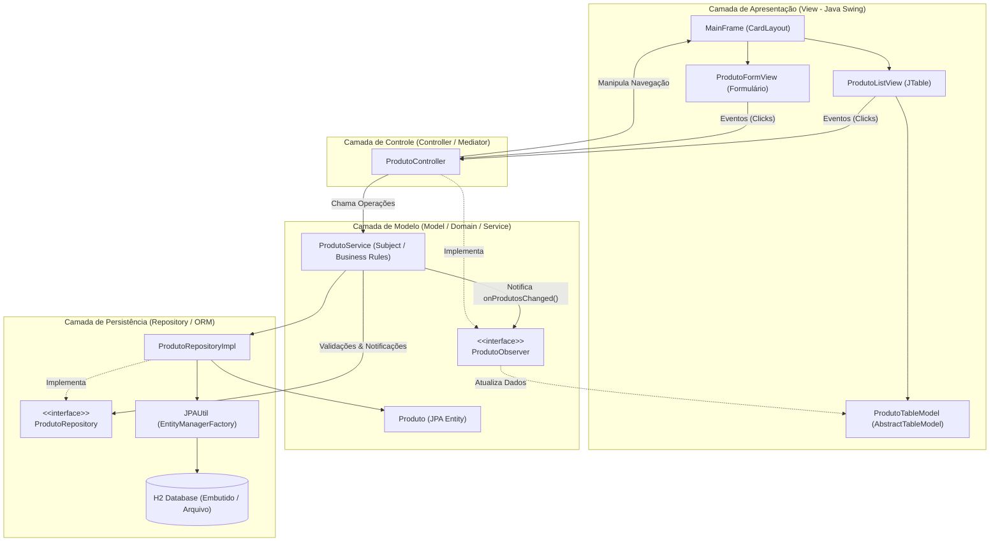
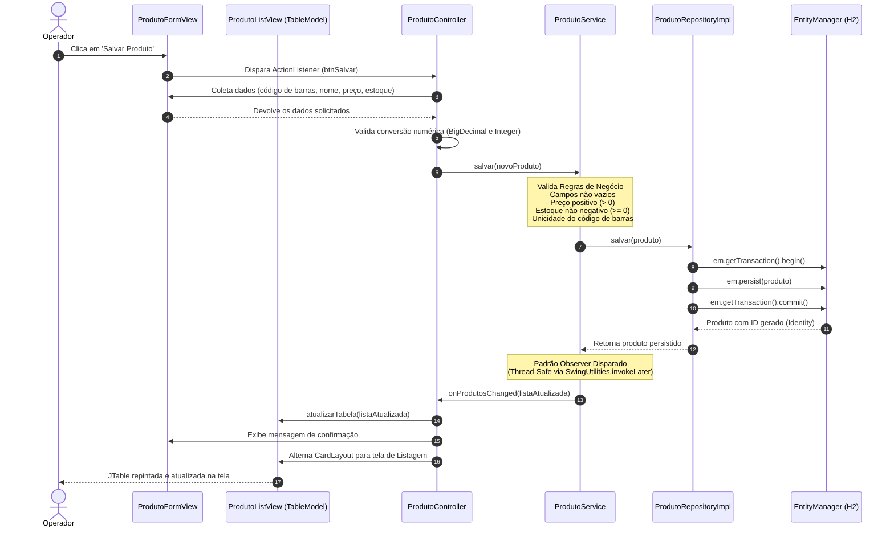
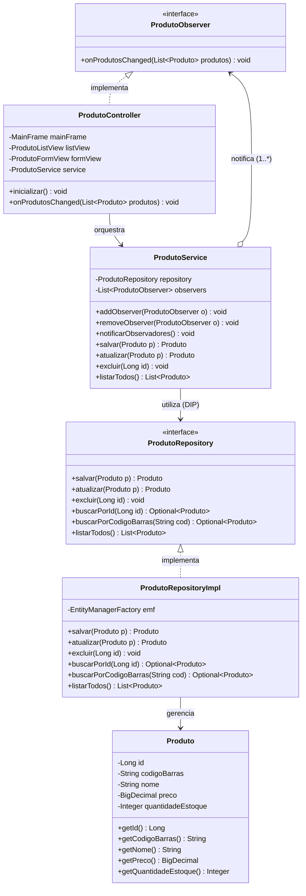
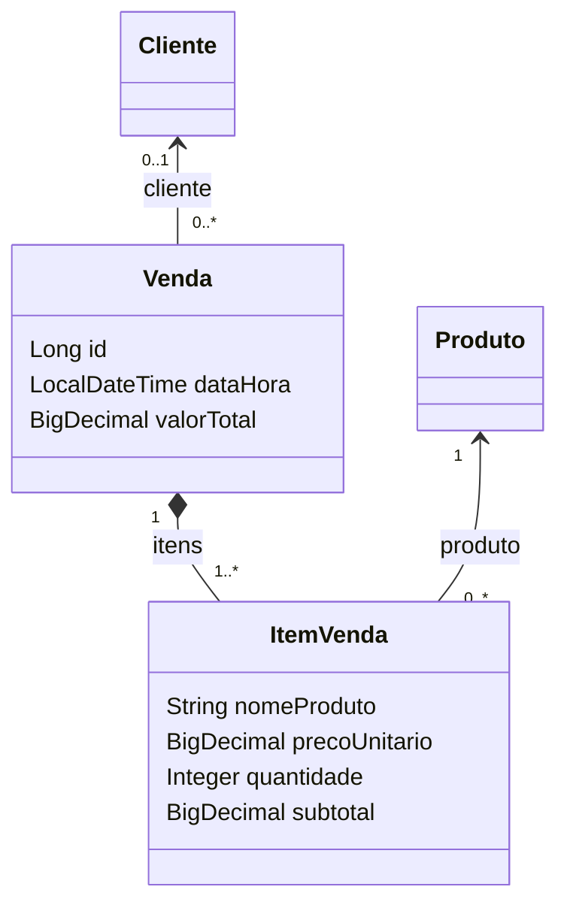

# PDV-Swing-JPA: Persistência de Dados com Frameworks de Interface Gráfica

> **Plano de Aula & Projeto Didático de Referência para Ensino Superior**  
> **Docente:** Prof. Cainã Antunes Silva  
> **Disciplina:** Técnicas de Programação II  
> **Tema da Aula:** Persistência de dados utilizando frameworks de interface gráfica  
> **Duração:** 50 minutos  

---

## 1. Identificação e Contextualização do Plano de Aula

Este projeto materializa a condução de uma aula teórico-prática de **50 minutos**, integrando a camada de apresentação desktop em **Java Swing** a um mecanismo robusto de persistência relacional com **JPA 3.1 / Hibernate 6** e banco embutido **H2 Database**. O desenvolvimento baseia-se em padrões consagrados de engenharia de software (**MVC, Observer, Repository e Inversão de Controle**), garantindo separação rigorosa de responsabilidades, reatividade de interface gráfica e segurança da informação.

### 1.1. Pré-Requisitos Curriculares
Para acompanhar esta aula, considera-se que os estudantes dominam competências consolidadas em semestres anteriores e em tópicos inaugurais desta disciplina:
- **Técnicas de Programação I (2º Semestre):** Conceitos fundamentais de Programação Orientada a Objetos (classes, encapsulamento, herança, polimorfismo, contratos de interface), tratamento de exceções e introdução à construção de interfaces gráficas.
- **Banco de Dados Relacional (2º Semestre):** Modelagem conceitual, lógica e física; integridade referencial e manipulação de dados com linguagem SQL (DDL e DML).
- **Técnicas de Programação II (Aulas Anteriores):** Fundamentos dos padrões de projeto GoF (criacionais, estruturais e comportamentais) e introdução aos padrões arquiteturais de interface com usuário (MVC, MVP e MVVM).

---

## 2. Objetivos de Aprendizagem

Ao término desta aula de 50 minutos, os discentes deverão atingir os seguintes objetivos educacionais:

### 2.1. Objetivos Cognitivos (Saber)
- **Compreender** como frameworks de interface gráfica orquestram a persistência de dados por meio da Inversão de Controle (*Inversion of Control* / *Hollywood Principle*) e da arquitetura orientada a eventos.
- **Identificar** o papel e as vantagens das ferramentas de Mapeamento Objeto-Relacional (ORM) na resolução do descompasso de impedância (*impedance mismatch*) e na prevenção de vulnerabilidades de injeção de SQL (*SQL Injection*).
- **Reconhecer** a aplicação prática dos padrões GoF *Observer* e dos padrões corporativos *MVC* e *Repository* em arquiteturas cliente desktop.

### 2.2. Objetivos Práticos / Procedimentais (Saber Fazer)
- **Conectar** a camada de apresentação visual construída em Java Swing a um repositório de dados mediado por JPA/Hibernate e banco de dados H2.
- **Implementar** a sincronização reativa de dados entre modelos de tabela (`AbstractTableModel`) e componentes visuais (`JTable`) utilizando eventos desacoplados do padrão *Observer*.

### 2.3. Objetivos Atitudinais (Ser / Agir)
- **Demonstrar pensamento crítico** na seleção e estruturação de camadas de software, valorizando boas práticas de código limpo, desacoplamento arquitetural e segurança da informação no ciclo de vida dos dados corporativos.

---

## 3. Conteúdo Programático

1. **Contexto de Persistência em Aplicações Gráficas:** A ação do usuário como gatilho do ciclo de vida dos dados; Inversão de Controle (IoC) em frameworks de GUI.
2. **Padrão Arquitetural MVC e Desacoplamento:** Fronteiras e contratos entre visualização (`View`), orquestração (`Controller`) e dados/regras de domínio (`Model`).
3. **Padrões de Projeto Aplicados ao Framework e à Persistência:**
   - **Observer (GoF):** `ActionListener` (captura na GUI) e `ProdutoObserver` / `fireTableDataChanged` (sincronização reativa de tela).
   - **Repository:** Abstração da coleção de entidades em memória e isolamento das operações de banco de dados.
4. **Camada ORM (JPA/Hibernate) & Banco Embutido:** Mapeamento declarativo de entidades (`@Entity`, `@Table`, `@Id`), controle transacional atômico (`commit`/`rollback`) e execução segura de transações sobre o H2 Database.
5. **Estudo de Caso Norteador:** Apresentação arquitetural e de código do módulo de Cadastro e Gestão de Produtos (Módulo PDV).

---

## 4. Estratégias Pedagógicas e Metodologia

A condução didática fundamenta-se na articulação entre o **Estudo de Caso Norteador**, a **Demonstração Conceitual Dirigida** e a **Aprendizagem Baseada em Projetos (PBL - Project-Based Learning)**:

- **Contextualização e Situação-Problema (Abertura):** A aula parte de uma demanda real do mercado de trabalho — o gerenciamento de retaguarda de produtos em um Ponto de Venda (PDV) — para instigar a reflexão sobre os vícios clássicos da programação desktop: mistura de comandos SQL dentro de eventos de clique de botões (`JButton`), telas que congelam e ausência de tratamento de transações.
- **Demonstração Conceitual Dirigida (Desenvolvimento):** Utilização do miniprojeto funcional como fio condutor para desconstruir e analisar trechos de código em conjunto com os fundamentos teóricos que eles materializam (arquitetura MVC, padrões GoF e ciclo de persistência com ORM).
- **Engajamento Ativo via PBL (Próximos Passos):** Lançamento de um desafio de desenvolvimento prático a ser executado em equipe nas aulas subsequentes, utilizando o repositório-base disponibilizado no GitHub como matriz inicial para a expansão de um PDV setorial completo.

---

## 5. Diagramas Arquiteturais (Mermaid)

### 5.1. Visão Geral da Arquitetura em Camadas (MVC Puro)



---

### 5.2. Diagrama de Sequência: Fluxo "Salvar Produto"

O diagrama a seguir detalha o ciclo de vida completo do cadastro de um produto, desde a interação do usuário na interface gráfica até a persistência no banco e a atualização reativa da tabela:



---

### 5.3. Diagrama de Classes: Padrões Repository & Observer



---

## 6. Justificativa Pedagógica do Stack Tecnológico

| Tecnologia / Decisão | Justificativa Didática |
| :--- | :--- |
| **Java 25+ (LTS)** | Linguagem padrão em instituições de ensino técnico e superior, fornecendo estabilidade corporativa aliada a recursos modernos da linguagem. |
| **Jakarta Persistence (JPA 3.1) & Hibernate 6.x** | Demonstra a separação fundamental entre **especificação padrão** (`jakarta.persistence.*`) e **provedor de implementação** (`org.hibernate.*`). Ensina aos alunos o paradigma ORM, ciclo de vida de entidades (*transient, managed, detached*), mapeamento de constraints e transações atômicas ACID sem acoplamento a SQL proprietário. |
| **H2 Database (Embutido / Arquivo)** | **Zero-Configuration:** Elimina a necessidade de servidores de banco externos (MySQL/PostgreSQL/Docker), permitindo que estudantes e desenvolvedores executem a aplicação imediatamente. Os dados persistem no diretório local `./data/pdv_db.mv.db`. |
| **Java Swing (Código Puro)** | Permite ao docente demonstrar a engenharia de componentes visuais (`JFrame`, `JPanel`), gerenciadores de layout (`CardLayout`, `GridBagLayout`, `BorderLayout`) e o controle rigoroso da **Event Dispatch Thread (EDT)**. |
| **FlatLaf Look & Feel** | Proporciona estética moderna e profissional à aplicação desktop, superando o aspecto arcaico dos temas tradicionais do Java. |
| **Maven Wrapper (`mvnw` / `mvnw.cmd`)** | Assegura reproducibilidade estrita de compilação e execução em qualquer plataforma (Windows, Linux, macOS), sem depender de instalação prévia do Maven no sistema operacional. |

---

## 7. Estrutura do Projeto

```text
exemplo_persistencia_JavaSwing/
├── .mvn/wrapper/                 # Binários e configuração do Maven Wrapper
├── data/                         # Criado em execução; banco H2 local (não distribuído)
├── src/
│   ├── main/
│   │   ├── java/br/gov/sp/cps/fatec/pdv/
│   │   │   ├── Main.java                        # Ponto de entrada (Bootstrap, Pure DI e Look&Feel)
│   │   │   ├── controller/
│   │   │   │   ├── ProdutoController.java       # Orquestrador MVC e ouvinte Observer
│   │   │   │   ├── VendaController.java         # Fluxo de registro de venda
│   │   │   │   └── HistoricoVendasController.java # Consulta assíncrona de vendas
│   │   │   ├── model/
│   │   │   │   ├── entity/
│   │   │   │   │   ├── Produto.java             # Entidade JPA mapeada para tabela 'produtos'
│   │   │   │   │   ├── Cliente.java             # Cliente opcional vinculado à venda
│   │   │   │   │   ├── Venda.java               # Cabeçalho e total da venda
│   │   │   │   │   └── ItemVenda.java           # Snapshot do produto/quantidade vendido
│   │   │   │   ├── observer/
│   │   │   │   │   └── ProdutoObserver.java     # Interface funcional do padrão Observer
│   │   │   │   ├── repository/
│   │   │   │   │   ├── ProdutoRepository.java   # Abstração de persistência (Interface)
│   │   │   │   │   ├── ProdutoRepositoryImpl.java # Implementação com JPA / EntityManager
│   │   │   │   │   ├── VendaRepository.java     # Contrato de registro da venda
│   │   │   │   │   ├── VendaRepositoryImpl.java # Venda e estoque na mesma transação
│   │   │   │   │   └── ItemVendaSolicitado.java # Entrada do carrinho
│   │   │   │   └── service/
│   │   │   │       ├── ProdutoService.java      # Regras de negócio e Observer
│   │   │   │       └── VendaService.java        # Serviço do fluxo de vendas
│   │   │   ├── util/
│   │   │   │   └── JPAUtil.java                 # Gerenciador Singleton do EntityManagerFactory
│   │   │   └── view/
│   │   │   │   ├── MainFrame.java               # Janela com CardLayout para alternância de telas
│   │   │   │   ├── ProdutoFormView.java         # Formulário de cadastro/edição
│   │   │   │   ├── ProdutoListView.java         # Tabela e ações CRUD
│   │   │   │   ├── VendaView.java               # Entrada e carrinho de venda
│   │   │   │   ├── HistoricoVendasView.java     # Histórico e detalhes de vendas
│   │   │   │   └── tablemodel/
│   │   │   │       └── ProdutoTableModel.java   # Modelo reativo da tabela de produtos
│   │   └── resources/
│   │       └── META-INF/
│   │           └── persistence.xml              # Configuração JPA para banco H2 e testes
│   └── test/java/br/gov/sp/cps/fatec/pdv/
│       ├── model/repository/
│       │   ├── ProdutoRepositoryTest.java       # Teste de persistência e operações CRUD
│       │   └── VendaRepositoryTest.java         # Venda, totalização e rollback de estoque
│       ├── model/service/
│       │   └── ProdutoServiceTest.java          # Validações de negócio e Observer
│       ├── controller/
│       │   └── ProdutoControllerValidationTest.java # Validação de entrada do formulário
│       └── view/
│           ├── ProdutoFormViewTest.java         # Estados e limites do formulário
│           ├── ProdutoListViewTest.java         # Filtro e seleção da listagem
│           ├── VendaViewTest.java               # Consistência do carrinho
│           └── HistoricoVendasViewTest.java      # Resumo e detalhes do histórico
├── pom.xml                                      # Descritor do Maven e dependências
├── src/assembly/distribution.xml                # Conteúdo do ZIP de distribuição
├── target/*-distribution.zip                    # ZIP de release (gerado no package)
├── mvnw / mvnw.cmd                              # Scripts executáveis do Maven Wrapper
├── target/<aplicacao>.jar + target/lib/         # Pacote de distribuição criado pelo Maven
└── README.md                                    # Plano de aula e documentação técnica integrada
```

---

## 8. Como Compilar e Executar

### Pré-requisitos
- **Java JDK 25** ou superior instalado (`java -version`).
- Acesso à internet na primeira execução para download automático de dependências pelo Maven Wrapper.

### 8.1. Execução via Maven Wrapper (Modo Desenvolvimento)

No terminal, posicionado na raiz do projeto:

#### No Windows (PowerShell / CMD):
```powershell
# Executar a aplicação diretamente pelo Maven Wrapper:
.\mvnw.cmd compile exec:java -Dexec.mainClass="br.gov.sp.cps.fatec.pdv.Main"
```

#### No Linux / macOS (Bash / Zsh):
```bash
./mvnw compile exec:java -Dexec.mainClass="br.gov.sp.cps.fatec.pdv.Main"
```

---

### 8.2. Compilação, Testes e Geração do Pacote de Distribuição

Para executar a suíte completa de testes e gerar o JAR com suas dependências:

```powershell
# Limpar, testar e empacotar:
.\mvnw.cmd clean package
```

O resultado **não é um JAR autossuficiente**. O diretório `target` contém o JAR da aplicação e suas dependências de execução na pasta `target/lib`. O manifesto do JAR referencia essas bibliotecas por um caminho relativo (`lib/`); ao distribuir, mantenha o JAR e a pasta `lib` juntos, preservando a estrutura:

```text
pdv/
├── exemplo_persistencia_JavaSwing-1.0.0.jar
└── lib/
    ├── hibernate-core-6.4.4.Final.jar
    ├── h2-2.2.224.jar
    └── ... demais dependências de execução
```

O `package` também gera automaticamente `target/exemplo_persistencia_JavaSwing-1.0.0-distribution.zip`. Esse ZIP contém o JAR executável, as dependências em `lib/` e este README; não contém testes, relatórios nem banco de dados. Extraia o ZIP mantendo a pasta `lib` ao lado do JAR. Também é possível copiar manualmente o JAR de `target` e `target/lib`.

O destino precisa ser gravável para que o programa crie a pasta `data` e o arquivo H2 na primeira execução. Os dados ficam em `data/pdv_db.mv.db`, relativo ao diretório de trabalho de onde o aplicativo é iniciado; mantenha esse diretório estável e faça backup do banco antes de atualizações.

Com Java 25 ou superior instalado e acessível no `PATH`, execute a partir do diretório que contém o JAR:

```powershell
# Windows PowerShell:
java -jar .\exemplo_persistencia_JavaSwing-1.0.0.jar
```

```bash
# Linux / macOS:
java -jar ./exemplo_persistencia_JavaSwing-1.0.0.jar
```

Como o classpath é relativo ao JAR, as dependências em `lib` são localizadas mesmo que `java -jar` seja executado a partir de outro diretório. A base H2, porém, é relativa ao diretório de trabalho atual.

Para executar sem copiar os arquivos após compilar, use o próprio `target` como diretório de execução:

```powershell
Push-Location .\target
java -jar .\exemplo_persistencia_JavaSwing-1.0.0.jar
Pop-Location
```

Para desenvolvimento, os comandos `compile exec:java` e a execução direta pela IDE continuam disponíveis nas seções seguintes.

---

### 8.3. Execução Direta via IDE (VS Code, IntelliJ IDEA, Eclipse ou NetBeans)
1. Abra a pasta do projeto como um projeto Maven existente na sua IDE preferida.
2. Aguarde a indexação das dependências do `pom.xml`.
3. Navegue até o arquivo `src/main/java/br/gov/sp/cps/fatec/pdv/Main.java`.
4. Clique com o botão direito e selecione **Run 'Main.main()'**.

### 8.4. Responsividade e Tratamento de Falhas

A preparação do banco, a carga inicial de demonstração e as operações de consulta e CRUD são executadas em tarefas de segundo plano com `SwingWorker`, evitando bloquear a Event Dispatch Thread (EDT). A criação e atualização dos componentes Swing continua restrita à EDT. Se a inicialização ou uma operação de banco falhar, a aplicação registra a exceção e apresenta uma mensagem ao usuário; uma falha na carga inicial impede a abertura da janela para não ocultar o problema.

O tema FlatLaf é aplicado como padrão e o tema do sistema operacional é usado somente como fallback caso o FlatLaf não possa ser configurado.

### 8.5. Registro detalhado da implementação em andamento

Este registro descreve as mudanças recentes para que seja possível acompanhar não apenas quais funcionalidades existem, mas também como elas se integram à arquitetura e como foram verificadas.

#### Etapa 1 — Inicialização, responsividade e falhas (concluída)

1. **Look & Feel:** `Main` configura FlatLaf antes de criar a interface. Nimbus não é aplicado depois; isso evita sobrescrever o tema inicialmente configurado. O tema do sistema é usado apenas se FlatLaf não puder ser configurado.
2. **Preparação do banco:** a criação do repositório e a carga de produtos de demonstração são executadas em `SwingWorker`, fora da EDT. A janela só é criada depois de a preparação terminar com sucesso.
3. **Operações da tela:** carregamento inicial, recarga, cadastro, edição e exclusão também são executados fora da EDT. A tabela, os diálogos e os demais componentes Swing continuam sendo manipulados na EDT.
4. **Prevenção de comandos repetidos:** enquanto uma operação está em andamento, os botões de ação ficam desabilitados. A tela volta a habilitá-los quando a tarefa termina, inclusive quando ocorre uma falha.
5. **Falhas explícitas:** erros de inicialização e persistência são registrados com a exceção completa e apresentados em uma mensagem ao usuário. Uma falha na carga de demonstração não é ignorada e impede que a aplicação continue como se tivesse iniciado normalmente. Em uma falha de inicialização, a fábrica JPA é fechada antes de apresentar o erro.

#### Etapa 2 — Experiência do módulo de produtos (em andamento)

1. **Busca imediata:** a página de catálogo agora filtra enquanto o usuário digita, procurando trechos sem diferenciar maiúsculas/minúsculas no nome ou no código de barras. O texto é tratado como literal, então caracteres como `.` e `*` não são interpretados como expressões regulares.
2. **Limpeza do filtro:** o botão **Limpar busca** remove o termo e volta a exibir todos os produtos. Um termo sem correspondências deixa a tabela vazia, sem alterar ou excluir os dados persistidos.
3. **Ordenação:** as colunas podem ser ordenadas pelos cabeçalhos da tabela. A busca e a ordenação atuam sobre a apresentação; não modificam a lista do repositório nem os registros do banco.
4. **Seleção segura:** ao alterar o termo de busca ou recarregar os dados, a seleção é limpa para evitar que uma linha visualmente diferente permaneça selecionada. Quando uma linha está selecionada, a view converte seu índice visível para o índice do modelo antes de devolver o produto; isso evita editar ou excluir um registro diferente após filtro ou ordenação.
5. **Contador:** o rodapé apresenta quantos produtos estão visíveis e quantos existem na lista carregada, por exemplo, `Exibindo 2 de 8 produto(s)`.
6. **Limites do formulário e domínio:** código de barras (50 caracteres) e nome (120 caracteres) seguem os limites definidos nas colunas JPA; os campos da tela impedem digitação/paste além desses limites. O serviço também valida os limites independentemente da interface e remove espaços externos do código e do nome antes de persistir.
7. **Preço:** a tela aceita vírgula ou ponto decimal, sem separador de milhar, e no máximo duas casas decimais. O domínio valida preço positivo, escala máxima de duas casas e o teto de `R$ 9.999.999.999,99` compatível com `precision = 12, scale = 2`.
8. **Estoque:** o campo aceita somente inteiro não negativo, de `0` a `2.147.483.647`; entrada vazia, decimal, negativa ou acima do limite recebe uma mensagem objetiva.
9. **Mensagens de validação:** erros detectados antes do acesso ao banco são apresentados como validação, enquanto falhas de infraestrutura continuam identificadas como falhas de operação. Mensagens de entrada indicam o formato esperado.

#### Arquivos e validação desta entrega

- `ProdutoListView` contém o campo de busca, o filtro e o sorter da tabela, o contador e a conversão correta da linha selecionada.
- `ProdutoFormView` limita o comprimento dos campos conforme o modelo e apresenta as regras de preço e estoque nas dicas de preenchimento.
- `ProdutoService` garante as regras de comprimento, faixa monetária, escala decimal e normalização textual, mesmo quando chamado sem a interface.
- `ProdutoControllerValidationTest` cobre os formatos de preço e estoque; `ProdutoServiceTest` cobre limites do domínio, normalização, edição, duplicidade entre produtos e rejeição de IDs inexistentes.
- `ProdutoFormViewTest` verifica transições entre cadastro e edição, limpeza do formulário e limites de comprimento; `ProdutoListViewTest` verifica filtro por nome e código, limpeza, busca sem resultados e identificação do produto após ordenação/filtro.
- `ProdutoController` e `Main` mantêm o trabalho de persistência fora da EDT, como descrito na etapa 1.
- Na conclusão do passo 2, a suíte tinha 23 testes. Com os testes de vendas, histórico, busca por nome na tela de venda e filtros no histórico, a suíte atual tem 33 testes; execute-os e gere o pacote no Windows com `.\mvnw.cmd clean package`. Os testes de componentes Swing rodam na EDT sem abrir uma janela e funcionam em ambiente sem monitor.

**Verificação manual recomendada para fechar a validação de ponta a ponta:** executar a aplicação em ambiente gráfico e verificar o carregamento inicial, a busca e ordenação, a edição/exclusão da linha selecionada após filtro, entrada nos limites e operação com erro de banco. Os testes atuais cobrem validação, domínio e componentes Swing, mas não abrem `MainFrame` nem simulam diálogos, pois isso depende de um ambiente gráfico.

### 8.6. Etapa 3 — Primeiro fluxo de vendas (em andamento)

Esta entrega inicia a expansão do PDV para registrar vendas usando os produtos já cadastrados. O fluxo foi implementado ponta a ponta no núcleo de domínio e na interface Swing.

#### Modelo persistido

- `Cliente` representa o nome opcional informado no fechamento da venda.
- `Venda` registra data/hora, valor total e o cliente opcional. Uma venda contém vários itens.
- `ItemVenda` associa a venda ao produto e mantém quantidade, preço unitário e nome do produto no momento da compra. O nome e o preço são snapshots para preservar os detalhes vendidos mesmo que o cadastro do produto mude posteriormente.
- Os mapeamentos estão registrados nas unidades JPA de produção e testes. O Hibernate cria/atualiza as tabelas `clientes`, `vendas` e `itens_venda` pela estratégia de schema já existente.



#### Regras e atomicidade

1. A venda exige ao menos um item e quantidades estritamente positivas.
2. O repositório consolida linhas repetidas do mesmo código para validar e baixar o estoque pela quantidade total.
3. Produto, estoque, itens, eventual cliente e cabeçalho da venda são tratados em uma única transação JPA.
4. Os produtos são lidos com bloqueio pessimista durante a transação. Se algum código não existir, o estoque for insuficiente ou a gravação falhar, ocorre rollback; nenhum item parcial, cliente da tentativa ou baixa de estoque deve permanecer.
5. Os valores unitários e nomes são obtidos do banco, nunca confiados à tela. O total é calculado no servidor como soma do preço unitário multiplicado pela quantidade.
6. O nome do cliente é opcional e limitado a 120 caracteres. Nesta primeira versão, não há cadastro/pesquisa de clientes nem identificador para deduplicação; se informado, cada venda cria seu registro de cliente. O fluxo ainda não inclui pagamento ou cancelamento.

#### Fluxo de interface e arquivos

- A página de catálogo possui o botão **Nova Venda**, que abre o terceiro cartão gerenciado por `MainFrame`.
- `VendaView` permite buscar produtos pelo nome ou informar o código de barras, definir a quantidade, adicionar itens ao carrinho e acompanhar o valor parcial atualizado a cada inclusão ou remoção.
- `VendaController` valida entradas simples na EDT e executa o fechamento em `SwingWorker`. O usuário recebe o identificador e o total confirmados; em caso de falha, recebe uma mensagem sem aparência de sucesso. Após o fechamento, o catálogo é recarregado para refletir o estoque.
- `VendaService` mantém o ponto de entrada do domínio; `VendaRepositoryImpl` controla o `EntityManager`, bloqueios, transação e rollback.
- Cobertura de `VendaRepositoryTest`: venda válida e baixa de estoque, totalização/snapshots, consolidação de itens repetidos, venda sem cliente, produto ausente e rollback integral quando um item fica sem estoque.
- `VendaViewTest` verifica a consistência do carrinho, a busca de produtos pelo nome e o cálculo do valor parcial.

**Próximos incrementos da etapa 3:** executar o fluxo manualmente com interface gráfica; implementar fluxo de clientes com identificador; avaliar pagamento e cancelamento com política explícita para estorno de estoque; ampliar testes dos estados assíncronos do controlador. O histórico e a consulta de vendas foram implementados na etapa 5.

### 8.7. Etapa 4 — Preparação para distribuição (em andamento)

#### Conteúdo do pacote e requisitos

- `mvnw clean package` compila, executa os testes e produz `target/exemplo_persistencia_JavaSwing-1.0.0.jar`.
- O JAR é leve e **não contém as dependências**. O plugin Maven copia as bibliotecas de execução para `target/lib`; o manifesto do JAR usa `Class-Path: lib/...`. A distribuição deve conter o JAR e a pasta `lib` no mesmo diretório relativo.
- O runtime requer Java 25 ou superior e um ambiente desktop capaz de abrir uma janela Swing. Não é necessário instalar servidor de banco: o H2 é incluído em `lib`.
- O primeiro início cria `data` no diretório de trabalho e inicializa o banco em `data/pdv_db.mv.db`. A pasta precisa permitir gravação e deve ser preservada entre versões para manter os dados.
- O banco local não faz parte do artefato e não deve ser substituído durante uma atualização. Faça backup do arquivo H2 com a aplicação fechada antes de atualizar.

#### Verificação do artefato

Após `clean package`, confira que o JAR existe, que `target/lib` contém as dependências runtime e que cada entrada indicada no manifesto aponta para um arquivo existente. O empacotamento Maven é validado junto com os testes automatizados. Ainda é necessário fazer um teste visual em outra máquina ou ambiente limpo com interface gráfica, copiando apenas o JAR e `lib`, e confirmar a criação do banco e o funcionamento dos fluxos.

As instruções de cópia, execução no Windows/Linux/macOS, localização dos dados e backup ficam na seção **8.2**. O ZIP de release agora é gerado automaticamente por Maven. Assinatura/publicação do artefato e smoke test automatizado em ambiente gráfico ficam para incrementos futuros.

### 8.8. Etapa 5 — ZIP de release e histórico de vendas (em andamento)

#### ZIP reprodutível

- O Maven Assembly Plugin lê `src/assembly/distribution.xml` e cria `target/exemplo_persistencia_JavaSwing-1.0.0-distribution.zip` na fase `package`.
- O pacote inclui o JAR principal, dependências de runtime no diretório relativo `lib/` e `README.md`. Ele não inclui arquivos H2, classes de teste ou relatórios.
- A estrutura preserva o `Class-Path` relativo do manifesto, de modo que o JAR continua executável com `java -jar` após extração.
- A validação deve confirmar a existência do ZIP, os três elementos do pacote e que as 19 dependências apontadas pelo manifesto estão presentes em `lib/`. Atualizações do número de dependências são incorporadas automaticamente a partir do escopo runtime do Maven.

#### Consulta do histórico

- O catálogo ganhou o botão **Histórico de vendas**, que abre uma página própria gerenciada pelo `CardLayout`.
- A tela apresenta o identificador, data/hora, cliente (ou “Consumidor não informado”) e total. Ao selecionar uma venda, mostra itens, quantidade, preço unitário e subtotal.
- O histórico permite combinar filtros por período (datas inicial e final em `dd/MM/aaaa`), nome do produto e nome do cliente; os resultados são atualizados durante a digitação e datas inválidas são informadas na tela.
- `VendaRepository.listarTodas` busca os relacionamentos de cliente, itens e produto na mesma consulta, evitando acesso a entidades lazy depois de fechar o `EntityManager`.
- `HistoricoVendasController` carrega o histórico e permite recarga fora da EDT com `SwingWorker`. Erros são registrados e exibidos no status da tela.
- Testes cobrem consulta de vendas com os relacionamentos carregados, a apresentação/seleção de detalhes e os filtros de período, produto e cliente na view.

**Ainda pendente para encerrar o passo 5:** testar a navegação e os detalhes numa sessão Swing real, confirmar o ZIP extraído e executado em máquina limpa e avaliar paginação/filtragem para históricos extensos.

---

## 9. Cronograma e Desenvolvimento da Aula (50 Minutos)

Este cronograma detalha a articulação didática entre exposição teórica, inspeção de código e demonstração funcional:

| Etapa | Tempo | Estratégia Pedagógica | Conteúdo Programático Desenvolvido |
| :---: | :---: | :--- | :--- |
| **1. Abertura e Situação-Problema** | 00min a 10min | Estudo de Caso Norteador e Contextualização Curricular | Apresentação pessoal, articulação com TP-I e Banco de Dados (PPC), objetivos de aprendizagem (CHA). Introdução à situação-problema do PDV comercial e riscos de acoplar telas a comandos SQL. |
| **2. Fundamentação Teórica e Arquitetura** | 10min a 25min | Exposição Conceitual Dialogada com Diagramas | Persistência de dados (RAM vs. Disco / ACID), caracterização do Java Swing com IoC, arquitetura MVC (SoC), revisão formal do padrão Observer (GoF), Repository (DDD) e funcionamento do ORM (JPA/Hibernate) para resolução do *impedance mismatch*. Apresentação da *stack* do projeto. |
| **3. Inspeção da Implementação (Estudo de Caso)** | 25min a 45min | Demonstração Dirigida de Código guiada por Diagrama de Sequência | Condução passo a passo do fluxo "Cadastrar Novo Produto" integrando teoria e prática:<br>• **View → Controller:** Captura de eventos (`ActionListener`) e sanitização de dados.<br>• **Controller → Model:** Validação de domínio em `ProdutoService`.<br>• **Model → Persistência:** Execução de transação ACID no `ProdutoRepositoryImpl` via ORM (`EntityManager` / H2).<br>• **Sincronização Reativa:** Disparo do padrão Observer na EDT do Swing (`fireTableDataChanged`) e repintura da `JTable`. |
| **4. Síntese e Fechamento** | 45min a 48min | Síntese Integradora e Validação Formativa | Recapitulação do fluxo integrado (Interface → Padrões → Persistência Segura) e abertura da sessão para esclarecimento de dúvidas e discussões. |
| **5. Proposição Prática e PBL** | 48min a 50min | Aprendizagem Baseada em Projetos (PBL) | Apresentação do repositório público no GitHub, proposta de extensão do núcleo PDV em equipes multidisciplinares (novas entidades e telas) e explicitação da rubrica de avaliação formativa. |

---

## 10. Avaliação da Aprendizagem e Proposta Prática (PBL)

Para consolidar as competências da disciplina, os estudantes utilizarão o repositório Git do projeto demonstrado (**PDV Core**) como matriz arquitetural inicial.

### 10.1. O Desafio Prático
Em equipes, os estudantes deverão estender a base do projeto para conceber e implementar um sistema completo de PDV aplicado a um **nicho de mercado** à escolha do grupo (ex.: farmácia, livraria, autopeças, pet shop).

### 10.2. Requisitos de Expansão
1. **Modelagem e Mapeamento ORM:** Criação de novas entidades e relacionamentos mapeados com JPA (ex.: `Cliente`, `Venda`, `ItemVenda`).
2. **Interface Gráfica Desacoplada:** Implementação das respectivas telas e tabelas Swing respeitando a separação MVC e a sincronização reativa com o padrão Observer.
3. **Regras de Negócio e Transações:** Tratamento de transações atômicas de vendas com validação de estoque e controle de exceções na camada Repository.
4. **Engenharia e Colaboração:** Utilização rigorosa de versionamento colaborativo com Gitflow e commits semânticos.

### 10.3. Critérios de Avaliação (Rubrica de Desempenho)
- **Aderência Arquitetural (MVC):** Rigor na separação de responsabilidades (a View não acessa o banco; o Controller apenas orquestra; a persistência é isolada no Repository).
- **Aplicação de Padrões de Projeto (GoF / Repository):** Utilização correta dos padrões Observer para atualização de interfaces e contratos de interface desacoplados.
- **Qualidade e Segurança da Persistência:** Mapeamento ORM coerente, integridade de transações (`commit`/`rollback`) e ausência de vulnerabilidades de SQL Injection.
- **Usabilidade e Sincronização da Interface:** Interface funcional, responsiva e com atualização consistente dos dados na tabela após operações de CRUD.
- **Processo de Engenharia e Versionamento:** Histórico de commits coerente, documentação técnica (`README.md` com diagramas) e divisão colaborativa de tarefas no Gitflow.

---

## 11. Recursos Didáticos

- **Quadro branco e marcadores:** Para esquematização visual e dedução dos fluxos arquiteturais durante a introdução teórica.
- **Projeção multimídia institucional:** Para exibição dos diagramas conceituais (Mermaid) e demonstração dirigida do código-fonte.
- **Plano de aula e roteiro didático:** Material estruturado para acompanhamento da aula teórico-prática.
- **Repositório de controle de versão (GitHub):** Roteiro e esqueleto do projeto disponibilizados aos estudantes como ponto de partida da atividade prática.

---

## 12. Referências Bibliográficas

- **FREEMAN, Eric; FREEMAN, Elisabeth.** *Use a Cabeça! Padrões de Projetos.* 2. ed. Rio de Janeiro: Alta Books, 2007.
- **GAMMA, Erich; HELM, Richard; JOHNSON, Ralph; VLISSIDES, John.** *Padrões de Projetos: Soluções Reutilizáveis de Software Orientados a Objetos.* Porto Alegre: Bookman, 2015.
- **GUERRA, Eduardo.** *Design Patterns com Java: Projeto Orientado a Objetos guiado por Padrões.* São Paulo: Casa do Código, 2014.
- **SIERRA, Kathy; BATES, Bert.** *Use a Cabeça! Java.* 2. ed. São Paulo: O'Reilly / Alta Books, 2005.
- **ANDRADE, S. S.** *Aprenda Java EE 8: Aplicações Para Web com Spring MVC e Hibernate.* São Paulo: SENAI-SP Editora, 2018.
- **ELMASRI, Ramez; NAVATHE, Shamkant B.** *Sistemas de Banco de Dados.* 7. ed. São Paulo: Pearson, 2018.
- **ECLIPSE FOUNDATION.** *Jakarta Persistence (JPA) Specification 3.1.* Disponível em: <https://jakarta.ee/specifications/persistence/>. Acesso em: 11 out. 2026.
- **H2 DATABASE ENGINE.** *H2 Database Engine Architecture and Documentation.* Disponível em: <http://www.h2database.com/html/main.html>. Acesso em: 11 out. 2026.
- **HIBERNATE COMMUNITY.** *Hibernate ORM User Guide.* Disponível em: <https://hibernate.org/orm/documentation/>. Acesso em: 11 out. 2026.
- **ORACLE CORPORATION.** *Java Platform, Standard Edition (Java SE) Documentation: Package javax.swing.* Disponível em: <https://docs.oracle.com/en/java/javase/>. Acesso em: 11 out. 2026.

---

## 13. Histórico de Versões e Gitflow

O repositório foi construído seguindo o modelo **Gitflow** e convenções de **Conventional Commits**:

- `main`: Branch estável contendo a versão consolidada para demonstração e produção.
- `develop`: Branch de integração contínua das novas funcionalidades.
- `feature/setup-and-persistence`: Configuração Maven, JPA Hibernate 6, H2 Database, Entidade `Produto`, Repositório e testes unitários.
- `feature/views-and-tablemodel`: Construção dos componentes visuais Swing (`ProdutoTableModel`, `ProdutoFormView`, `ProdutoListView`, `MainFrame`).
- `feature/controller-and-observer`: Implementação da orquestração do `ProdutoController`, serviço de validações `ProdutoService` e sincronização via `ProdutoObserver`.
- `docs/didactic-documentation`: Elaboração completa da documentação pedagógica, plano de aula e diagramas arquiteturais.

---

*Prof. Cainã Antunes Silva*  
*Técnicas de Programação II*
